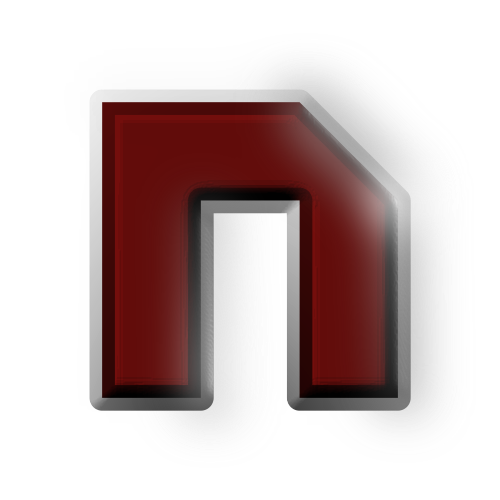

<div align="center">
  
  <h1>NuVelocity Engine</h1>
  <h3>A C++ game engine, re-implementing Reflexive Entertainment's Velocity Engine.</h3>
</div>

It powers games such as FreeRS42, providing modular 2D game development, asset management, rendering, audio, and scene management.

## Features

- Modular engine architecture
- 2D rendering (SDL3-based)
- Asset and resource management (through physfs, zlib, and other SDL libraries)
- Audio playback and management (through SDL_mixer)
- Support for screens and property-based object system

## Build Instructions

1. Install dependencies: SDL3, SDL3_image, SDL3_mixer, SDL3_ttf, zlib, physfs
2. Clone repository and submodules
3. Configure with CMake:
   ```sh
   cmake -S . -B build
   ```
4. Build:
   ```sh
   cmake --build build
   ```

## License

Engine and main code are licensed under the Mozilla Public License 2.0 (MPL 2.0).
For third-party code, see the `third_party` directory for license information.

NuVelocity is not affiliated with or endorsed by Reflexive Entertainment. This is
an unofficial community project run by fans of the series with an interest in
preserving the legacy. All product names, logos, and brands are property of their
respective owners.

## Contact

For questions, open an issue. Code contribution guidelines are still being written.
